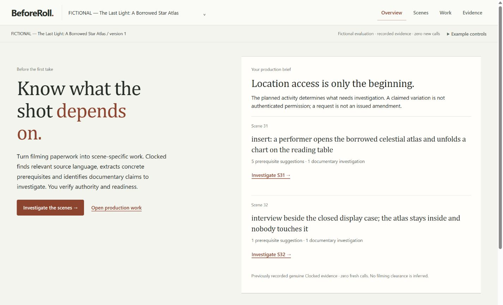
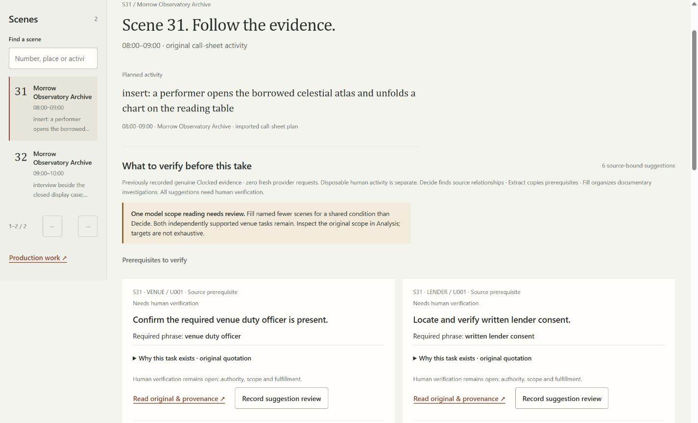
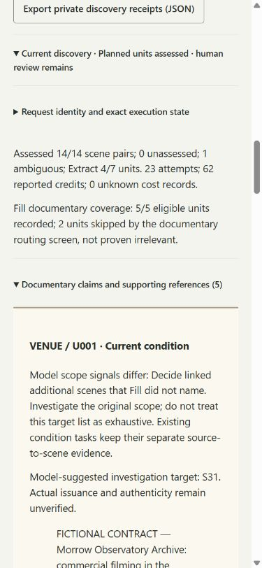
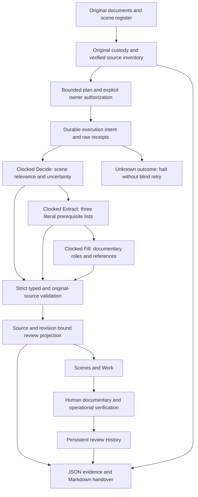

# BeforeRoll — Know what the shot depends on.

BeforeRoll turns filming paperwork and planned scene activities into **scene-specific documentary review work using Clocked**. It connects what a crew intends to do with the original conditions, separates prerequisites from uncertain documentary claims, and gives coordinators an evidence-backed handover. People remain responsible for verifying permission and operational readiness.

**[Watch the actual-use demonstration](https://youtu.be/Ng_lMzWNlTs)** · [Try locally](#try-beforeroll-locally) · [Judge walkthrough](#guided-judge-walkthrough) · [Technical guide](docs/submission/TECHNICAL_WRITEUP.md)



## The real problem

A location manager can arrange access to a building without resolving every activity planned inside it. A lender may separately require written consent before an object is handled. Conservation conditions can specify protective equipment or specialist supervision. A request to extend an agreement is not the issued amendment itself, and an old production photograph is not evidence that yesterday's arrangements apply today.

For a coordinator preparing the next shot, these distinctions become practical questions: **Which conditions concern this scene? Which document says so? What must someone locate, verify or arrange before the crew proceeds?** The answers can be spread across a venue agreement, lender conditions, correspondence and a call sheet. Shared location names and keyword searches do not establish whether an interview beside a case has the same requirements as opening the object inside it.

The problem is informed by [historic-house conservation guidance](https://www.icon.org.uk/conservation-hub/caring-for-your-collections/filming-in-historic-houses.html) and [Film London's heritage-location guidance](https://filmlondon.org.uk/latest/filming-in-heritage-locations-the-national-trust). BeforeRoll's examples are fictional paperwork, not those organizations' requirements or legal advice. No market statistics, customer study or productivity measurement is claimed.

## What BeforeRoll demonstrated

**The Last Light — A Borrowed Star Atlas** is a fictional production filming inside an observatory archive. The crew has venue access. Scene 31 asks an actor to physically open and unfold a borrowed atlas; Scene 32 is an interview beside its closed display case.

The accepted showcase processes **four original fictional production documents**, seven documentary units and two scenes: **fourteen assessed source-to-scene pairs**. The original call sheet is preserved separately. Genuine recorded Decide, Extract and Fill execution produces **six expected scene-bound prerequisite suggestions and two documentary investigations, with zero unsupported final prerequisites in this accepted showcase**.

| Work to investigate | Scene 31: opening and unfolding | Scene 32: case-only interview |
|---|---|---|
| Venue duty officer present | Required personnel to verify | Required personnel to verify |
| Written lender consent | Locate and verify | Not transferred from handling scene |
| Supporting book cradle | Confirm protection | Not transferred |
| Padded transfer tray | Confirm protection | Not transferred |
| Collections conservator throughout the take | Confirm supervision | Not transferred |
| Claimed narrow variation; Consent Schedule CS-9 | Separate documentary investigation | No inherited handling exception |
| Requested wider Variation VA-17 extension | No new authority inferred | Separate **unissued-request** investigation |

That is **five prerequisites for Scene 31 and one for Scene 32**. Both retain their own source-bound venue task. The atlas-handling requirements do not automatically follow the location into the interview scene.

The lender source **claims** that a narrow variation exists and cites **Consent Schedule CS-9**, which is not supplied in the packet. BeforeRoll asks a human to locate and verify it; it neither authenticates the claimed variation nor turns a reference into an imposed prerequisite. The correspondence requesting a wider **Variation VA-17** extension remains unissued. Neither statement grants filming permission.



## The complete user workflow

**Original documents and scene plans → verified source inventory → Decide → Extract → Fill → source-bound suggestions → human review → Work and History → evidence-backed handover.**

| Stage | Coordinator action | Application result |
|---|---|---|
| Intake | Import supported original documents and call sheet; inspect and correct extracted text | Original-byte custody, document revisions and scene register |
| Verify | Confirm represented text/source identity; select whole documents and scenes | Complete represented unit inventory and preview of scene/passage checks |
| Analyze | In authenticated owner mode, explicitly authorize the bounded preview | Durable, source/version-bound Clocked execution; no manual clause curation or passage-specific questions |
| Investigate | Open scene prerequisites and documentary investigations | Exact original quotations, positions, provider provenance and unresolved qualifications |
| Review | Record an explicit suggestion acknowledgment; separately investigate documentary scope and operational conditions | Persistent human records, with authority and fulfillment kept separate |
| Coordinate | Use Scenes, Work and History; revise documents when plans change | Consistent task projections; affected evidence becomes stale rather than silently reactivating |
| Handover | Review and export current JSON evidence and Markdown handover | Source-linked outstanding work and history; private encrypted separate-copy recovery |

Evaluation Mode follows the same application navigation using **previously recorded genuine responses**. It does not authorize or execute fresh provider requests. Human acknowledgments made there are disposable fictional reviews.

## Why Clocked matters

### Decide: connect the activity to the language

The production describes unfolding an atlas; the lender regulates “direct manipulation.” **Decide** assesses each selected scene/passage using the existing typed `activity_link` and `granted_for_scene` questions. It guides semantic relevance routing and preserves uncertainty, instead of assuming that every clause mentioning the same room applies identically to every shot.

The application inventories all represented units before those assessments. The coordinator selects whole verified documents and scenes, not researcher-chosen clauses. A high probability is model interpretation, **never proof that a grant was issued or applies legally**. Ambiguous and unprocessed work remains visible.

### Extract: turn relevant language into concrete review work

**Extract** applies one reusable three-category contract:

- Required written documents.
- Required physical protections.
- Required on-site personnel.

For the handling scene, these become written lender consent, a book cradle, a padded tray and a conservator—not a generic “check the permit” task. Literal phrases and Unicode source positions are validated against the original passage and document before a card is projected. Exact quotation proves correspondence to the source; it does not prove the model classified it correctly.

### Fill: distinguish a documentary claim from a prerequisite

**Fill** produces typed documentary records: the source's **claimed role**, original statement, referenced supporting instrument, original scope wording and suggested investigation target. Literal fields disable inference. These records distinguish current conditions, claimed-issued variations, requests, historical references and unresolved text.

This changes the work: the cited **CS-9 schedule remains an investigation to locate and verify**, rather than becoming an invented prerequisite; the wider **unissued request** receives its own investigation. Fill does not authenticate a signature, independently establish issuance, or conclusively determine legal applicability. Its target list is not exhaustive authority.

### Composition: source → model evidence → accountable work

A lender passage enters with its original identity and positions. Decide links it to planned handling; Extract identifies literal requirements; Fill separates a claimed variation and its referenced instrument from imposed duties. BeforeRoll validates the responses, binds each accepted result to its scene and source revision, and projects review cards. The same cards and human acknowledgments appear in **Scenes, Work, History and the exported handover**.

Clocked supplies the semantic interpretation and literal/typed evidence. BeforeRoll supplies validation, conservative composition, persistence and accountable human review. Removing Clocked leaves useful document and manual-review tools, but removes this automated scene-to-condition investigation and the task specificity demonstrated here.

## Demonstrated comparison

The same fictional packet was compared without weakening the deterministic baseline:

| Configuration | Observed outcome |
|---|---|
| **AI off** | Originals, source inventory, deterministic checks, warnings and manual investigation remain available |
| **Decide + Extract** | Six expected prerequisites, **plus a cited CS-9 instrument incorrectly classified as an additional prerequisite** |
| **Decide + Extract + Fill** | Six correct prerequisites and two documentary investigations; CS-9 is retained as an investigation |

The two-endpoint result is a **read-only reconstruction from the same recorded evidence**, not a separate live provider run. The accepted three-endpoint recording contains **23 requests: 14 Decide, four Extract and five Fill**, consuming **62 provider-reported credits**. Added Fill accounts for five calls/32 credits. Credits are provider units, not currency. Summed transport time was 15,467.7490 ms, not measured coordinator effort.

**Remaining disagreement:** the general venue Fill record names only Scene 31. Independent Decide/Extract evidence supports venue personnel for **both scenes**, so both tasks remain and the interface discloses the disagreement. We do not claim all five Fill scope readings were correct.



The wider adaptive Batch B campaign used 39 requests/150 credits and retains failed attempts. The earlier core campaign is separate. These are bounded development results, not a universal accuracy benchmark or evidence of measured time savings.

## Architecture



This is one local Node application, not a collection of microservices. Fill runs once per eligible documentary unit rather than once per scene/passage pair; its routing/skips remain inspectable.

| Module | Responsibility |
|---|---|
| `server.mjs`, `public/` | Local HTTP/authenticated owner boundaries and browser experience |
| `src/source-intake.mjs`, `src/source-originals.mjs` | Intake, original-byte custody and source identity |
| `src/production-workspace.mjs`, `src/permit-intelligence.mjs` | Scene/document state and represented source units |
| `src/core-discovery.mjs`, `src/intelligence-workflow.mjs` | Inventory, relevance plan, conservative task projection and Decide contract |
| `src/discovery-execution.mjs` | Durable dispatch intent, raw receipts, execution fences and uncertainty |
| `src/literal-requirements.mjs`, `src/literal-extract-contract.json` | Reusable Extract contract and exact literal validation |
| `src/documentary-intelligence.mjs`, `src/documentary-fill-contract.json` | Typed Fill records, literal evidence and documentary investigations |
| `src/coordinator-tasks.mjs`, `src/production-history.mjs`, `src/production-dossier.mjs` | Human-review projection, history and exports |
| `src/recorded-last-light.mjs`, `src/evaluation-mode.mjs` | Integrity-checked historical replay and isolated fictional runtime |
| `src/secure-backup.mjs`, `src/production-lifecycle.mjs` | Verified encrypted backup and separate-copy recovery |

[Discovery architecture](docs/CLOCKED_CORE_DISCOVERY_ARCHITECTURE.md) explains the original core; [the current technical write-up](docs/submission/TECHNICAL_WRITEUP.md) covers its three-endpoint composition.

## Trust and authority model

**Identifying a requirement is not fulfilling it. Reviewing a requirement is not granting filming permission.**

| Responsibility | What it establishes | What it does not establish |
|---|---|---|
| Clocked interpretation | Suggested scene relevance, literal prerequisites and documentary roles | Authentic issue, legal force, exhaustive applicability or clearance |
| BeforeRoll deterministic validation | Typed contract, identity, revision, exact source text/positions and consistent projection | Correctness of every semantic classification |
| Original evidence and provenance | Which imported bytes and passage support a finding | Truth or authenticity of the document's claims |
| Human documentary review | Accountable interpretation/acknowledgment with rationale | Automatic satisfaction of operational conditions |
| Human operational verification | Recorded checks of personnel, protection and supporting evidence | Permission merely because a checklist was reviewed |
| Responsible production/issuing authority | Actual permission and readiness decisions outside model inference | Delegation of filming authorization to Clocked or BeforeRoll |

Unresolved evidence remains work. A referenced instrument missing from the imported packet differs from an absent imported original; neither is silently invented. A proposed extension stays proposed. Absence of a suggestion is never permission.

## Technical implementation

- **Original custody:** source hashes and original bytes are preserved alongside verified text, source units and revisions. Unicode codepoint `[start,end)` positions are checked at unit and original-document level; JavaScript UTF-16 indices are not substituted.
- **Strict contracts:** typed fields, enums, quotations, offsets, request/response hashes and scene/document/contract identities are checked before projection and again when durable evidence is read. Invalid or partial results do not become successful analysis.
- **Revision binding:** source and scene changes retire affected evidence. Returning to earlier text does not resurrect stale conclusions or consumed execution identities.
- **Durable execution:** explicit preview/version/operator/billing acknowledgment precedes owner-mode dispatch. Intent is stored before the network call. Exact raw responses, status, timings, model and returned usage/credit information remain evidence. Uncertain outcomes halt without automatic retries.
- **Shared projection:** source-bound coordinator tasks, human reviews, Work, History, JSON and Markdown derive from consistent evidence rather than independent copies of conclusions. Export review/version checks prevent stale approval from silently producing changed evidence.
- **Recovery:** private backups use scrypt and AES-256-GCM; verification and journal/original checks precede separate-copy restoration. Partial recovery is not represented as complete success.
- **Boundaries:** authenticated owner mode retains protected sources and live execution. Evaluation uses temporary fictional data and a forbidden/counting provider transport. The server uses a static allowlist, strict CSP and direct-loopback origin/host checks.

The stack is Node.js ESM HTTP, native browser modules and local evidence/original storage. There are **no third-party runtime dependencies, CDN assets or build service**.

## Try BeforeRoll locally

Clone this repository or download its source, install **Node.js 20 or newer**, and run from the repository root:

```sh
git clone https://github.com/chizzydev/beforeroll.git
cd beforeroll
node scripts/release/evaluate.mjs
```

Open **http://127.0.0.1:3000**. No `npm install`, build, account, `.env` or API key is required. Release verification uses Node **24.13.0** / npm **11.6.2** on Windows; 20 is the declared minimum, not a separately tested binary.

On Windows, double-click **`Start-BeforeRoll-Evaluation.cmd`** to open an available localhost port automatically, or use the terminal command above. If port 3000 is occupied:

```sh
node scripts/release/evaluate.mjs --port=3001
```

Stop with **Ctrl+C** or type **`stop`** in the launcher's terminal. It disposes its temporary data and reports actual provider-call count. Do not close the terminal if you want the session to remain available.

Evaluation opens The Last Light and includes U01/U02 historical examples, original fictional documents and genuine recorded Clocked evidence. Reviews/reset affect only that temporary process. Two tabs on one server share state; separate processes have separate sandboxes. This is **local Evaluation, not a publicly hosted multi-user application**. Do not tunnel an owner server or import private data into a shared demonstration.

Owner mode supports authenticated fresh-document intake and explicitly authorized live analysis with server-side credentials. That workflow is distinct from this no-key replay; no live requests are needed to judge the showcase. See [the user guide](docs/LAST_LIGHT_USER_GUIDE.md).

## Guided judge walkthrough

[Watch the completed actual-use demonstration](https://youtu.be/Ng_lMzWNlTs), or use this sequence:

1. **Overview → Investigate scene** for S31. Read the planned activity, five prerequisite suggestions and one documentary investigation.
2. Open the lender task's **Why this task exists**, then **Read original & provenance**. Inspect the original handling conditions and exact evidence. Return to the scene.
3. Inspect the **CS-9** documentary investigation. It asks for supporting evidence; it is not an imposed prerequisite or authenticated variation.
4. Switch to **S32**. It retains the venue officer and unissued-extension investigation, without inheriting the handling consent/protections/conservator.
5. In the source investigation/analysis, inspect the visible Fill scope disagreement. Both independently supported venue tasks remain.
6. **Record suggestion review** using fictional reviewer/rationale and explicit review-only affirmation. Save, then inspect the same acknowledgment in **Work** and **Evidence → History**. It does not mark a condition fulfilled.
7. Open **Evidence → Exports & recovery** and download the actual **Markdown handover** and JSON evidence. Check outstanding work and separate recorded/human origins.
8. Explore U01/U02 through the chooser/example controls. **Example controls → Reset examples** restores the fictional seed after confirmation.

[Detailed guide](docs/LAST_LIGHT_USER_GUIDE.md) · [Demonstration contents](docs/submission/DEMONSTRATION.md)

## Verification and evidence

| Accepted public release result | Evidence scope |
|---|---|
| **661 passing application tests** | Native application, security, isolation, source/revision, review, export and recovery regressions |
| **109 passing frozen tests** | Stage 0/1 experimental contract, baseline and execution-fence harness |
| **Zero failures/skips** | Accepted release runs; controlled transports are offline engineering evidence |
| **23 genuine Last Light requests** | 14 Decide / four Extract / five Fill; 62 reported credits |
| **Six prerequisites + two investigations** | Accepted source-grounded showcase, including preserved uncertainty |
| **Independent Windows owner acceptance completed** | Owner-confirmed final essential workflow; separate from agent-operated browser/test evidence |

Run the complete public gate without launching:

```powershell
powershell.exe -NoProfile -ExecutionPolicy Bypass -File .\scripts
elease\Verify-Release.ps1 -NoLaunch
```

Or run its portable components on any supported terminal:

```sh
node scripts/release/verify-distribution.mjs
node scripts/verify-coordinator-evidence.mjs
node scripts/verify-last-light-recording.mjs
node scripts/release/test-public.mjs
node --test experiments/p0b/stage0.test.mjs experiments/p0b/stage1/stage1.test.mjs
```

`npm test` also runs the public native suite. All these commands are network-free with respect to Clocked. Never replay frozen paid campaigns or remove consumed execution fences.

The recording [fixture](fixtures/audit/LAST_LIGHT_COMPLETE_RECORDED_v1.json) is pinned to SHA-256 `2cc34e798efe694df045418082e29f8b6c3b5b35f600f4167305a9ce5cc30954`. Genuine responses, frozen expectations, historical failures and bounded comparisons remain under `verification/` and `fixtures/audit/`.

A **separate protected archive-integrity assertion** remains local: it verifies private/encrypted/disposable preservation archives excluded by the owner. It is not required by, shipped with, or claimed as passed by the public 661-test procedure. No assertion was weakened to remove that dependency. [Verification scopes and current evidence](docs/submission/RELEASE_VERIFICATION.md).

## Project structure and development history

```text
server.mjs                      Local application server
public/                         Browser modules and editorial interface
src/                            Intake, discovery, validation, review and recovery
fixtures/                       Fictional originals and genuine recorded evidence
tests/                          Portable native regression suite
experiments/p0b/                Frozen network-free experimental harness
scripts/release/                Credential-free launcher and verification gate
verification/                   Frozen campaigns and reproducibility evidence
docs/LAST_LIGHT_USER_GUIDE.md    Current interactive guide
docs/submission/                Technical, demo and submission documentation
docs/README.md                  Current versus historical documentation index
RELEASE_MANIFEST.json           Current public content hashes
NOTICE.md                       Preserved rights and attribution
```

Development was AI-assisted. The first Git snapshot contains an assembled application; its date is **not proof that all development began on that commit date**. Subsequent source/evidence work, failures and actual release checkpoints remain auditable.

The published history is the previously audited derivative excluding 13 unrelated other-product research images. Original/public commit identities are documented in [the history map](docs/submission/PUBLIC_HISTORY_MAP.json); author/date/message and BeforeRoll source/failure history were retained. This final documentation cleanup is a normal commit, not a rewrite of those commits. The protected original repository and excluded archives remain untouched. [Development and credits](docs/submission/DEVELOPMENT_AND_CREDITS.md).

[The documentation index](docs/README.md) separates current instructions from historical milestone reports; older “not yet implemented” statements describe their dated builds. Existing **UNLICENSED / all rights reserved** declarations remain: public inspection is not an unapproved open-source license. See [NOTICE](NOTICE.md).

## Limitations and scope

The showcase is a small, exposed, developer-authored **fictional** packet, not a held-out benchmark or real-production trial. Generalized reliability, commercial adoption and productivity gains have not been measured. Exact quotations can still be misclassified; routing, limited Fill target-subset expressiveness and the disclosed venue-scope disagreement remain constraints.

Humans must verify documentary authenticity, actual issuance, applicability, missing supporting instruments, physical fulfillment and filming authority. No automatic permit issuance or filming clearance occurs. Evaluation is local replay, not fresh model output or public multi-user hosting. The completed video and public source are available; **official competition submission is a separate action and has not been claimed**.

## The central idea

Documentary requirements depend on **what the shot physically does**, not simply where it takes place or whether a document exists. BeforeRoll makes those relationships traceable and actionable—from original language to scene-specific work—while keeping human responsibility intact.
